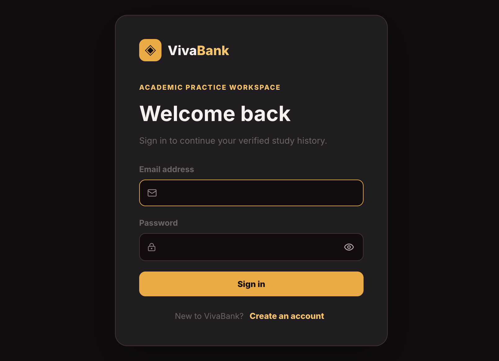

# VivaBank

VivaBank is an academic practice workspace for engineering students. It combines course-specific question banks, MCQ and short-answer practice, AI-assisted viva preparation, Supabase authentication, and persisted assessment history.



## What it includes

- Email/password signup and login with Supabase Auth
- Persistent sessions and email-confirmation handling
- Student profiles protected by Row Level Security (RLS)
- Course-specific question banks for:
  - Computer Networks
  - Data Structures & Algorithms
  - Operating Systems
  - Database Systems
  - Machine Learning & AI
  - Web Engineering
- Separate MCQ and short-answer practice modes
- AI-generated viva questions with saved question IDs
- Server-backed quiz and viva assessment attempts
- Server-calculated scores and persisted submitted answers
- Idempotent assessment submission to prevent duplicate results
- Dashboard progress, exam history, XP, streak, and leaderboard surfaces
- Dark/light workspace themes

## Tech stack

- React 19
- TypeScript
- Vite
- Tailwind CSS 4
- Supabase Auth and PostgreSQL
- Lucide React icons
- Gemini question generation through the server-side development proxy

## Quick start

### Requirements

- Node.js 20 or newer
- npm
- A Supabase project

### Install and run

```bash
npm install
npm run dev
```

Open the local URL printed by Vite, usually:

```text
http://localhost:5173
```

### Environment variables

Create `.env.local` in the project root:

```env
VITE_SUPABASE_URL=https://your-project.supabase.co
VITE_SUPABASE_PUBLISHABLE_KEY=your-publishable-key
GEMINI_API_KEY=your-server-side-gemini-key
```

The publishable Supabase key is safe for browser use when RLS is configured correctly. Never put a Supabase service-role key, database password, or Gemini secret in a `VITE_` variable or commit them to Git.

`.env.local` is ignored by Git. Use [.env.example](./.env.example) as the starting point for local configuration.

## Supabase setup

Apply migrations in order from the Supabase SQL Editor or through the Supabase CLI:

1. [001_profiles_auth.sql](./supabase/migrations/001_profiles_auth.sql)
2. [002_question_storage.sql](./supabase/migrations/002_question_storage.sql)
3. [003_secure_assessment_attempts.sql](./supabase/migrations/003_secure_assessment_attempts.sql)

### Important migration note

There are currently two competing version-004 migration files:

- [004_secure_viva_rubric_snapshots.sql](./supabase/migrations/004_secure_viva_rubric_snapshots.sql)
- [004_secure_viva_snapshots.sql](./supabase/migrations/004_secure_viva_snapshots.sql)

Both redefine the same assessment RPC functions. Do **not** apply both. Resolve the migration conflict and give the selected migration a unique version before applying it to a database. The application code expects the shared RPC contracts:

```text
start_assessment_attempt(text, text, uuid[], text)
submit_assessment_attempt(uuid, jsonb)
```

The broader reference schema is available at [supabase/schema.sql](./supabase/schema.sql), but migrations are the preferred deployment path.

## How the main flows work

### Authentication

1. A student signs up with email, password, and display name.
2. Supabase Auth handles credentials and session persistence.
3. A database trigger creates the matching profile.
4. RLS limits private profile access to the signed-in student.
5. If email confirmation is enabled, the student confirms the email before signing in.

### Practice quiz

1. The student selects a course, mode, and difficulty.
2. The app selects questions matching the chosen mode.
3. The server creates an assessment attempt with an idempotency key.
4. Answers are submitted through the protected RPC.
5. PostgreSQL calculates the result from trusted question data.
6. The completed attempt and answers are available after refresh and on another device.

### AI viva

1. The app requests structured questions from the server-side Gemini proxy.
2. Questions are validated and saved in Supabase.
3. Saved UUIDs are associated with a server-backed exam attempt.
4. The existing examiner UI provides provisional feedback while the student answers.
5. Final scoring is returned by the secure submission RPC.
6. The result is included in persisted exam history and dashboard metrics.

AI feedback is guidance, not proof of mastery. The application should not present heuristic rubric matching as perfectly objective grading.

## Security model

- Passwords are handled only by Supabase Auth.
- Browser code never uses a service-role key.
- Assessment records are owned by `auth.uid()`.
- Students cannot submit an attempt belonging to another student.
- Correct answers, rubric snapshots, and answer keys should remain server-only in the final migration design.
- Duplicate starts use idempotency keys.
- Completed submissions return the existing result instead of creating another result.
- Client-provided scores, XP totals, user IDs, and correctness flags are not authoritative.
- AI-generated question creation alone does not count as learning activity.

## Useful commands

```bash
npm run dev       # Start the Vite development server
npm run lint      # Run ESLint
npm run build     # Type-check and create a production build
npm run preview   # Preview the production build
```

## Project structure

```text
src/
├── App.tsx                 # App shell, navigation, practice, and viva flows
├── Dashboard.tsx           # Dashboard presentation
├── metrics.ts              # Local metric model and derived dashboard calculations
├── questionsService.ts     # Supabase question persistence
├── supabaseClient.ts       # Browser Supabase client configuration
├── supabaseService.ts      # Assessment, metrics, and leaderboard queries
├── auth/
│   ├── AuthContext.tsx     # Session and authentication state
│   ├── AuthPage.tsx        # Sign-in and sign-up UI
│   └── auth.css            # Authentication styling
└── assets/

supabase/
├── migrations/             # Ordered database migrations
└── schema.sql              # Reference schema
```

## Testing checklist

### Local checks

```bash
npm run lint
npm run build
git diff --check
```

### Supabase checks

After applying the migrations to a development project, verify:

- Signup, email confirmation, login, refresh, and logout
- Duplicate email and invalid credential errors
- A student can read only their own profile and attempts
- A student cannot submit another student's attempt ID
- Starting an attempt twice with the same idempotency key returns one attempt
- Submitting an attempt twice returns one completed result
- Duplicate question IDs and malformed answer payloads are rejected
- Missing answers follow the documented submission policy
- Practice quiz scoring remains unchanged after viva scoring is enabled
- Completed viva results remain visible after refresh and on another device
- Gemini failures show a retryable error without exposing the API key

Live Supabase verification must be performed against a configured development project; a local build does not prove database policies are working.

## Current limitations

- The version-004 migration conflict must be resolved before deploying the secure viva snapshot functions.
- Rubric scoring is deterministic and heuristic unless a separately validated evaluator is introduced.
- Some dashboard calculations still have legacy local metric compatibility code and should be fully derived from persisted attempts in the next backend phase.
- Production bundle optimization can continue by lazy-loading the practice flow and any future PDF/report-generation dependencies.

## License

This project is currently maintained as a private VivaBank application. Add a project-specific license before redistributing it.
